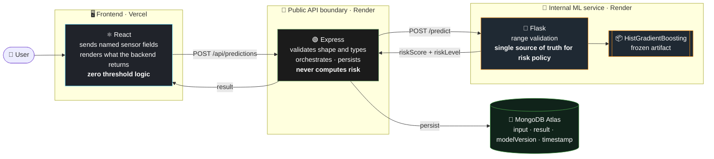
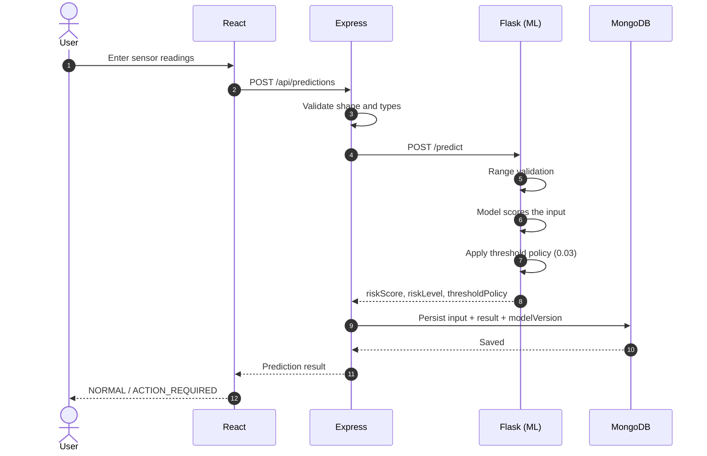

<div align="center">

# ⚙️ Predictive Maintenance Risk Assessment System

### From raw sensor readings to a cost-aware maintenance decision — an end-to-end ML + web engineering project.

<p>
  
  
  
  
  
</p>

<p>
  
  
  
  
  
  
</p>

**[🚀 Live App](https://failure-prediction-app.vercel.app)** &nbsp;•&nbsp;
**[🔌 Backend API](https://failure-prediction-app-nbsw.onrender.com)** &nbsp;•&nbsp;
**[🧠 ML Service](https://failure-prediction-app-ml.onrender.com/health/live)**

</div>

> ⏳ **Free-tier hosting note:** the backend and ML services spin down after inactivity and may take **~50 seconds** to respond on the first request after idling. Opening the [ML health link](https://failure-prediction-app-ml.onrender.com/health/live) first wakes it up.

<!-- 📸 Add a screenshot or a short GIF of the app here, e.g.:
<p align="center"></p>
-->

---

## 📑 Table of Contents

- [What this is (and isn't)](#-what-this-is-and-isnt)
- [Architecture](#-architecture)
- [API](#-api)
- [ML methodology](#-ml-methodology)
- [Results](#-results)
- [Engineering decisions](#-engineering-decisions)
- [Known limitations](#-known-limitations)
- [Testing](#-testing)
- [Run it locally](#-run-it-locally)
- [Project structure](#-project-structure)
- [Tech stack](#-tech-stack)

---

## 🎯 What this is (and isn't)

A full-stack application that **estimates machine failure risk from operating sensor readings**, trained and evaluated on a public benchmark dataset. It is built as a portfolio project demonstrating a complete ML + web engineering pipeline:

| 🔬 Data & Modeling | 🛠️ Engineering |
|---|---|
| Data leakage analysis | Validated model-serving API |
| 5-model comparison | Layered validation (Express + Flask + Mongoose) |
| Calibration evaluation | Single source of truth for risk policy |
| Cost-sensitive threshold selection | Persistence with model versioning |
| Bootstrap confidence intervals | Unit + mocked-integration tests |

> [!IMPORTANT]
> This project uses the **AI4I 2020 Predictive Maintenance Dataset** (UCI) — a public, **synthetic** benchmark, **not real industrial telemetry**. The risk score is an **uncalibrated model output**, not a guaranteed real-world probability of failure. Every claim below is backed by an experiment; where something is a limitation, it's stated as one.

---

## 🏗️ Architecture

### System overview



### Request lifecycle



### Who owns what

| Layer | Responsible for | Deliberately does **not** |
|---|---|---|
| ⚛️ **React** | Sending named sensor fields, rendering results | Contain any threshold or risk logic |
| 🟢 **Express** | Request validation, orchestration, persistence, the only public API | Compute risk itself |
| 🐍 **Flask** | Loading the frozen model, ML-specific range validation, risk classification | Face the public internet |
| 🍃 **MongoDB** | Storing input, result, model version, timestamps | Store any fabricated ground-truth field |

> 🔒 Flask is **never public-facing** — Express is the only public API boundary.

---

## 🔌 API

### Express (public)

| Method | Route | Description |
|:---:|---|---|
| `POST` | `/api/predictions` | Validate → call ML service → persist → return result |
| `GET` | `/api/predictions?page=&limit=` | Paginated prediction history |
| `GET` | `/api/predictions/:id` | Fetch one prediction |
| `DELETE` | `/api/predictions/:id` | Delete one prediction |
| `DELETE` | `/api/predictions` | Bulk reset *(requires `X-Admin-Key` header)* |

### Flask (internal only)

| Method | Route |
|:---:|---|
| `GET` | `/health/live`, `/health/ready` |
| `GET` | `/model-info` |
| `POST` | `/predict` |

### Example

<table>
<tr>
<td width="50%" valign="top">

**Request** — `POST /api/predictions`

```json
{
  "air_temperature_k": 300,
  "process_temperature_k": 310,
  "rotational_speed_rpm": 1500,
  "torque_nm": 40,
  "tool_wear_min": 100,
  "type": "M"
}
```

</td>
<td width="50%" valign="top">

**Response**

```json
{
  "modelVersion": "ai4i-hgb-v1-20260830",
  "riskScore": 0.0001,
  "riskLevel": "NORMAL",
  "thresholdPolicy": {
    "threshold": 0.03,
    "costRatioAssumed": "5:1"
  },
  "predictedAt": "2026-09-01T10:39:30.000Z"
}
```

</td>
</tr>
</table>

### Risk policy

The policy is **binary**:

```text
riskScore <  0.03   →   ✅ NORMAL
riskScore >= 0.03   →   🚨 ACTION_REQUIRED
```

---

## 🧪 ML methodology

### Pipeline

```mermaid
flowchart LR
    A["📊 AI4I 2020"] --> B["🔍 Leakage analysis"]
    B --> C["✂️ Drop failure-subtype<br/>+ identifier columns"]
    C --> D["🎲 Stratified 60/20/20 split<br/>random_state=42"]
    D --> E["🧰 sklearn preprocessing<br/>fit on train only"]
    E --> F["🏁 Compare 5 models<br/>by validation PR-AUC"]
    F --> G["🎯 Calibration check"]
    G --> H["💰 Cost-sensitive<br/>threshold selection"]
    H --> I["🔒 Test set<br/>touched exactly once"]
    I --> J["📏 Bootstrap CIs"]
    J --> K["📦 Frozen artifact"]

    style I fill:#3b1d1d,stroke:#e5534b,color:#fff
    style K fill:#10231a,stroke:#47a248,color:#fff
```



Failure-subtype columns were dropped after **verifying** a 99.73% overlap with the target — measured, not assumed — along with identifier columns.

### Model comparison

Validation **PR-AUC** (higher is better):

```text
Dummy                 0.034  █
Logistic Regression   0.407  ██████████
Random Forest         0.590  ██████████████
XGBoost               0.777  ███████████████████
HistGradientBoosting  0.817  ████████████████████  ← selected
```

| Model | Validation PR-AUC |
|---|:---:|
| Dummy | 0.034 |
| Logistic Regression | 0.407 |
| Random Forest | 0.590 |
| XGBoost | 0.777 |
| **HistGradientBoosting** ✅ | **0.817** |

The model was selected **empirically, based on observed validation performance under a fixed protocol** — not for sophistication.

### Calibration

Isotonic and sigmoid calibration were both tested and **rejected**, because the uncalibrated model had the lower Brier score:

| Variant | Brier score |
|---|:---:|
| **Uncalibrated** ✅ | **0.0124** |
| Sigmoid | 0.0138 |
| Isotonic | 0.0139 |

The model output is therefore explicitly **not** a calibrated probability.

### Cost-sensitive threshold

- **Cost assumption:** FN : FP = **5 : 1** — an explicit modeling assumption, not a sourced industry figure
- **Objective:** minimize expected cost, with a deterministic tie-break
- **Selected threshold:** **`0.03`**

### Bootstrap robustness check

> [!WARNING]
> Over 1000 bootstrap resamples of the validation set, the threshold is **not highly stable**: only **37%** of resamples reproduce exactly `0.03`, with a 90% interval of **[0.03, 0.57]**. This is disclosed as a limitation. The threshold was kept as-is rather than cherry-picked post hoc against the test set.

### Feature importance

Permutation importance (a sanity check, **not causal**): **air temperature** and **torque** dominate, followed by **rotational speed** and **tool wear**. Machine **type** contributes negligibly.

---

## 📊 Results

### Final locked metrics — test set, touched once

<div align="center">

| ROC-AUC | PR-AUC | Precision | Recall | F1 |
|:---:|:---:|:---:|:---:|:---:|
| **0.980** | **0.808** | **49.6%** | **82.4%** | **0.619** |

</div>

### Confusion matrix

<div align="center">

|  | **Predicted: NORMAL** | **Predicted: ACTION_REQUIRED** |
|---|:---:|:---:|
| **Actual: no failure** | ✅ TN = **1875** | ⚠️ FP = **57** |
| **Actual: failure** | ❌ FN = **12** | ✅ TP = **56** |

</div>

### Bootstrap 95% confidence intervals

| Metric | Point estimate | 95% CI |
|---|:---:|:---:|
| Recall | 82.4% | **[72.6%, 91.2%]** |
| Precision | 49.6% | **[40.7%, 58.6%]** |

> 💡 The low precision is a deliberate trade-off: with a 5 : 1 cost assumption, the policy prefers catching failures (recall 82.4%) over avoiding false alarms.

---

## 🧠 Engineering decisions

| Decision | Why |
|---|---|
| **One policy owner** (Flask) | Risk classification lives in exactly one place; React and Express can never drift out of sync with the model |
| **Flask is internal only** | Express is the single public boundary, so all input handling and exposure is controlled in one layer |
| **Layered validation** | Express checks shape/types, Flask checks ML-specific ranges, Mongoose schema constraints act as a final line of defense |
| **Binary policy, not tiers** | Only one threshold was justified by an experiment; inventing extra tiers would have been unsupported |
| **No ground-truth field in the DB** | No real observed outcomes exist, so storing one would fabricate data |
| **Admin key instead of full auth** | Single-user portfolio scope; the one destructive endpoint is protected by a shared secret |

---

## ⚠️ Known limitations

Documented honestly, as part of the engineering story:

- 🧪 The dataset is a public, **simulated** benchmark — not production telemetry
- 🎲 `riskScore` is **not a calibrated probability** (calibration was tested and rejected)
- 📉 The `0.03` threshold is **not highly stable** under bootstrap resampling
- 🔀 An **order-based robustness check** showed a real, unresolved PR-AUC drop (0.817 → ~0.70) when splitting by row order instead of stratified sampling. This is an open finding, **not** evidence of temporal leakage — the dataset's row order is not a timestamp
- 📏 Input validation bounds are **training-data-evidence ranges**, not physical or industry safety limits
- 🔐 **No full user authentication** — single-user portfolio scope, with one destructive endpoint protected by a shared admin key instead
- 🗄️ **No live MongoDB integration test in CI** — verified manually against MongoDB Atlas in production instead

---

## ✅ Testing

| Area | Coverage | Status |
|---|---|:---:|
| 🐍 **Flask / ML** | 17 unit tests, plus live HTTP smoke tests of valid, invalid and malformed requests and health endpoints | ✅ 17/17 |
| 🟢 **Express** | 17 tests using a mocked Mongoose model plus real Mongoose schema validation | ✅ 17/17 |
| ⚛️ **Frontend** | Production build compiles cleanly | ✅ |
| 🌐 **End-to-end** | Real request through React → Express → Flask → MongoDB Atlas and back, confirmed in production | ✅ |

---

## 💻 Run it locally

**Prerequisites:** Node.js, Python 3, and a MongoDB connection string (MongoDB Atlas works).

```bash
# 1. Clone
git clone https://github.com/aayushtiwari307/failure-prediction-app.git
cd failure-prediction-app
```

**2. ML service (Flask)**

```bash
cd backend/ml-service
pip install -r requirements.txt
python app.py
```

**3. Backend (Express)**

```bash
cd backend
cp .env.example .env     # then fill in the values below
npm install
node index.js
```

**4. Frontend (React)**

```bash
cd client
cp .env.example .env
npm install
npm start
```

### Environment variables

| File | Variable | Purpose |
|---|---|---|
| `backend/.env` | `MONGO_URI` | MongoDB connection string |
| `backend/.env` | `ML_SERVICE_URL` | Internal Flask URL (default `http://localhost:5001`) |
| `backend/.env` | `ADMIN_KEY` | Shared secret for bulk delete (leave unset to disable it) |
| `backend/.env` | `CLIENT_ORIGIN` | Allowed CORS origin (default `http://localhost:3000`) |
| `backend/.env` | `PORT` | Express port (default `5000`) |
| `client/.env` | `REACT_APP_API_URL` | Backend base URL, no `/api` suffix (e.g. `http://localhost:5000`) |

### Run the tests

```bash
# Flask / ML
cd backend/ml-service
pip install -r requirements-dev.txt
pytest

# Express
cd backend
npm test
```

---

## 🗂️ Project structure

```text
failure-prediction-app/
├── client/                      # ⚛️ React frontend
│   └── src/
│       ├── App.js
│       └── App.test.js
├── backend/                     # 🟢 Express API (public boundary)
│   ├── index.js
│   ├── models/
│   │   └── Prediction.js        # Mongoose schema
│   ├── routes/
│   │   ├── predictions.js
│   │   ├── predictions.test.js
│   │   └── predictions.mongoose-validation.test.js
│   └── ml-service/              # 🐍 Flask ML service (internal only)
│       ├── app.py
│       ├── artifact/
│       │   ├── model.pkl        # frozen model
│       │   └── metadata.json    # source of truth for locked metrics
│       ├── tests/
│       │   └── test_app.py
│       ├── requirements.txt
│       └── requirements-dev.txt
└── README.md
```

---

## 🧰 Tech stack

| Layer | Technology |
|---|---|
| **Frontend** | React · deployed on Vercel |
| **API** | Express (Node.js) · deployed on Render |
| **ML service** | Flask · scikit-learn (HistGradientBoosting) · deployed on Render |
| **Database** | MongoDB Atlas |

---

<div align="center">

Built by **[Aayush Tiwari](https://github.com/aayushtiwari307)** — engineered for rigor, not for inflated claims.

⭐ If you found this project useful, consider giving it a star.

</div>
